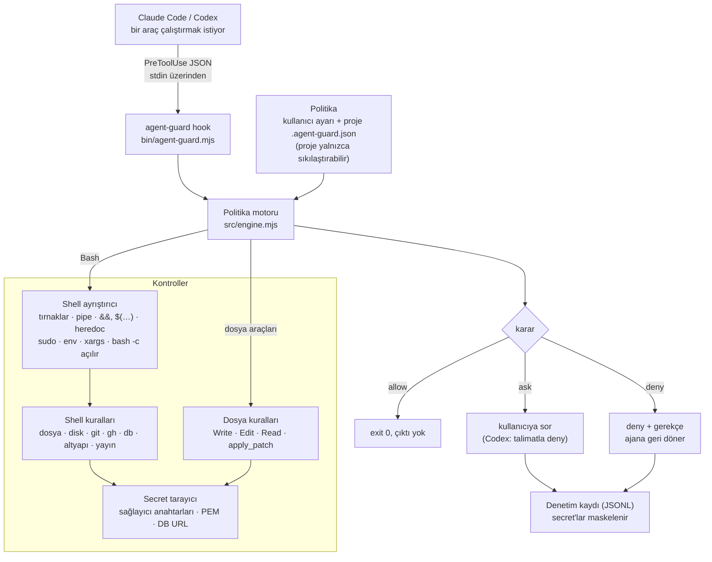

# agent-guard

**AI kodlama ajanları için güvenlik bariyeri.** agent-guard, **Claude Code** ve **Codex** için yazılmış bir `PreToolUse` hook'udur. Bir araç çağrısının gerçekte ne yapacağını okur. Çağrı veri silecekse, bir secret'ı sızdıracaksa ya da ajanın kendi güvenlik kontrollerini kapatacaksa onu engeller veya onaya bağlar.

[English](README.md) | Türkçe

<picture>
  <source media="(prefers-color-scheme: dark)" srcset="docs/assets/how-it-works-dark.svg">
  
</picture>

```text
$ agent-guard check "git push --force origin main"
DENY  git push --force origin main
  - [deny] git.force-push: Force push to protected branch `main` rewrites shared history.

$ agent-guard check "rm -rf node_modules dist"
ALLOW rm -rf node_modules dist
```

## Neden

Ajanlar komutları sizin yetkilerinizle çalıştırır. Yerleşik izin kuralları ise komutun yalnızca *başını* eşleştirir. Örneğin `Bash(git push:*)` iznini verdiğinizde `git push --force origin main` da izinli olur; `Bash(rm:*)` verdiğinizde `rm -rf ~` da. agent-guard ise komutu gerçekten ayrıştırır: tırnaklar, pipe'lar, `&&`, `$(…)`, heredoc'lar ve `sudo`/`env`/`xargs`/`bash -c` sarmalayıcıları dahil. Kararı da gerçekte çalışacak komuta göre verir.

- **Üç sonuç var.** Hiçbir zaman istenmeyecek işlemler `deny` alır (`rm -rf ~`, `main`'e force push, koda gömülü API anahtarı). Bazen doğru olan ama insan onayı gerektiren işlemler `ask` alır (`git reset --hard`, `terraform destroy`, `npm publish`). Geri kalan her şey sessizce geçer.
- **Gürültü düşük.** Günlük geliştirme komutları serbest: `rm -rf node_modules`, `git push origin feature/x`, `cp .env.example .env`, `prisma migrate dev`.
- **Kurcalamaya dayanıklı.** Ajan, korumayı kapatmak için `.agent-guard.json`, `.claude/settings.json` veya `.codex/hooks.json` dosyalarını sessizce düzenleyemez. Klonladığınız bir repo da politikanızı gevşetemez.
- **Yerel ve hızlı.** Sıfır bağımlılık, ağ çağrısı yok. Bir kontrol bir milisaniyenin çok altında sürer.

## Nasıl çalışır

Her araç çağrısı kısa ömürlü tek bir Node sürecinden geçer. Ağa hiçbir şey gönderilmez.



## Kurulum

Gereksinim: `PATH` üzerinde **Node.js 18.17+**.

**Claude Code (plugin):**

```text
/plugin marketplace add Tngc93/agent-guard
/plugin install agent-guard@agent-guard
```

**Claude Code (plugin sistemi olmadan):**

```bash
git clone https://github.com/Tngc93/agent-guard ~/.agent-guard
node ~/.agent-guard/bin/agent-guard.mjs install claude
```

**Codex:**

```bash
git clone https://github.com/Tngc93/agent-guard ~/.agent-guard
node ~/.agent-guard/bin/agent-guard.mjs install codex
```

Ardından Codex'te **`/hooks`** komutunu çalıştırıp hook'a güvenmeniz (trust) gerekir. Codex, güvenilmemiş hook'ları atlar.

Codex'te "ask" kararı yoktur. Bir kural onay isteyecekse agent-guard çağrıyı reddeder ve ajana durup sizden onay almasını söyler.

## Yapılandırma

| Katman | Konum | Politikayı gevşetebilir mi? |
| --- | --- | --- |
| Kullanıcı | `~/.config/agent-guard/config.json` | Evet |
| Proje | `<repo>/.agent-guard.json` | Yalnızca kullanıcı config'inde `"trustProjectConfig": true` varsa |

Proje dosyası, ajanın üzerinde çalıştığı repoda durur. Bu yüzden varsayılan olarak politikayı yalnızca **sıkılaştırabilir**. Tüm anahtarların açıklaması ve örnek dosyalar için İngilizce [README](README.md#configuration) ile [`examples/`](examples) klasörüne bakın.

## Sınırlar

agent-guard bir **emniyet kemeridir, sandbox değildir**. Hızlı, deterministik ve desen tabanlı bir kontroldür; işletim sistemi seviyesinde izolasyonun yerini tutmaz. Zaten var olan bir script'in, bir `Makefile` hedefinin ya da derlenmiş bir programın içini göremez. Kasıtlı olarak gizlenmiş komutları her zaman yakalayamaz. Varsayılan olarak **fail-open** çalışır: hook çökerse ajanın normal izin akışı devreye girer. Ajanınızın sandbox ve izin modlarıyla birlikte kullanın, onların yerine değil.

## Lisans

[MIT](LICENSE) © Berk Arcak
